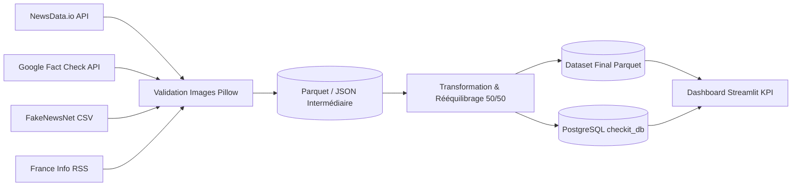

# 🛡️ Pipeline ETL d’acquisition multimodale pour la détection de désinformation

<p align="center">
  
  &nbsp;
  
  &nbsp;
  
  &nbsp;
  
  &nbsp;
  
</p>

<p align="center">
  <strong>Projet 12 — Formation AI Engineer OpenClassrooms</strong>
</p>

<p align="center">
  Pipeline ETL automatisé d’extraction multimodale (Texte + Image), validation qualité, orchestration Apache Airflow, stockage PostgreSQL/Parquet et monitoring KPI.
</p>

---

## 📋 Table des matières

- [🎯 Présentation](#-présentation)
- [✅ Fonctionnalités](#-fonctionnalités)
- [🏗️ Architecture](#️-architecture)
- [🛠️ Technologies utilisées](#️-technologies-utilisées)
- [🌐 Sources de données multimodales](#-sources-de-données-multimodales)
- [🔄 Pipeline de transformation et rééquilibrage](#-pipeline-de-transformation-et-rééquilibrage)
- [🗄️ Stockage hybride : Parquet et PostgreSQL](#️-stockage-hybride--parquet-et-postgresql)
- [⏱️ Orchestration Apache Airflow](#️-orchestration-apache-airflow)
- [📊 Monitoring et Dashboard KPI](#-monitoring-et-dashboard-kpi)
- [📁 Structure du projet](#-structure-du-projet)
- [📦 Installation locale](#-installation-locale)
- [⚙️ Configuration](#️-configuration)
- [▶️ Lancement](#️-lancement)
- [🔐 Sécurité et éthique](#-sécurité-et-éthique)
- [⚠️ Limites](#️-limites)
- [🔭 Perspectives](#-perspectives)
- [👤 Auteur](#-auteur)

---

## 🎯 Présentation

La start-up fictive **CheckIt.AI** développe des solutions d’intelligence artificielle pour lutter contre la propagation des fausses informations sur le web et les réseaux sociaux.

Pour entraîner et maintenir des modèles de classification multimodale (combinent **NLP** pour le texte et **Computer Vision** pour l’image), l’équipe Data Science a besoin d’un jeu de données fiable, équilibré et régulièrement mis à jour.

Le **Projet 12** met en place un pipeline ETL complet et industrialisé permettant de :

- collecter automatiquement des publications multimodales depuis **4 sources complémentaires** (APIs REST, flux RSS XML et archives CSV) ;
- valider strictement le couplage **1:1** entre chaque texte et son image téléchargée localement ;
- nettoyer, normaliser et rééquilibrer les classes (`50 % real` / `50 % fake`) ;
- orchestrer l’exécution quotidienne avec **Apache Airflow** ;
- stocker les données au format **Apache Parquet** (pour l’IA) et dans **PostgreSQL** (pour la persistance et l’audit) ;
- surveiller la qualité des données et la santé du pipeline via un **dashboard Streamlit** et un plan de monitoring dédié.

> [!NOTE]
> Ce projet distingue rigoureusement les **opinions controversées** (jugements subjectifs relevant de la liberté d’expression) de la **désinformation** (assertions factuelles objectivement fausses vérifiées par des organismes certifiés).

---

## ✅ Fonctionnalités

- ✅ Extraction parallèle depuis **4 sources multimodales** (NewsData.io, Google Fact Check Tools, FakeNewsNet, France Info RSS)
- ✅ Téléchargement et contrôle d’intégrité des images avec **Pillow** (type MIME, dimensions minimales, détection de fichiers corrompus)
- ✅ Génération d’identifiants déterministes (`item_id`) par hachage MD5 pour garantir l’idempotence
- ✅ Nettoyage textuel (suppression HTML, normalisation Unicode/espaces) et standardisation des dates en **ISO 8601**
- ✅ Dédoublonnage strict sur `item_id` et contrôle de présence physique des images
- ✅ Rééquilibrage reproductible des classes (`50 % real` / `50 % fake`, `random_state=42`)
- ✅ Export double format (**Apache Parquet** et **JSON**) + chargement idempotent dans **PostgreSQL** (`ON CONFLICT DO UPDATE`)
- ✅ Orchestration quotidienne automatisée avec **Apache Airflow** (`checkit_multimodal_etl`)
- ✅ Journalisation centralisée horodatée dans `./logs/etl.log` (`INFO`, `WARNING`, `ERROR`)
- ✅ Dashboard interactif **Streamlit** de suivi des KPI qualité, des doublons et des logs

---

## 🏗️ Architecture

### Architecture du pipeline ETL (DAG Airflow)



### Parcours d’une donnée multimodale

```text
Collecte brute (API / RSS / CSV)
        ↓
Génération de l'identifiant déterministe (item_id)
        ↓
Téléchargement et vérification binaire de l'image (Pillow)
        ↓
Stockage normalisé par source (.parquet / .json)
        ↓
Consolidation, dédoublonnage et nettoyage textuel
        ↓
Rééquilibrage 50 % real / 50 % fake
        ↓
Export IA (.parquet) + Chargement idempotent PostgreSQL
```

---

## 🛠️ Technologies utilisées

<p align="center">
  
  
  
</p>

| Besoin | Technologie |
|---|---|
| Langage | Python 3.11 |
| Gestionnaire d’environnement | `uv` / `venv` |
| Orchestration ETL | Apache Airflow (`checkit_multimodal_etl`) |
| Extraction & Parsing | `requests`, `BeautifulSoup4`, `xml.etree.ElementTree` |
| Traitement & Validation d’images | `Pillow` (PIL) |
| Transformation des données | `Pandas`, `PyArrow` |
| Format analytique IA | Apache Parquet / JSON |
| Base de données relationnelle | PostgreSQL (`psycopg2-binary`) |
| Dashboard de monitoring | Streamlit & Plotly |
| Configuration & Logs | `python-dotenv` (`.env`), `logging` |

---

## 🌐 Sources de données multimodales

Quatre sources complémentaires ont été sélectionnées et implémentées dans le répertoire `Extractors/` afin d’assurer une couverture bilingue (`fr` / `en`) et un équilibre entre informations vérifiées et infox avérées :

| Source | Type | Langue | Script extracteur | Classes générées | Rôle dans le dataset |
|---|---|---|---|---|---|
| **NewsData.io** | API REST (Presse) | `fr` | `Extractors/newsdata_extractor.py` | `real` | Actualité journalistique récente en français. |
| **Google Fact Check Tools** | API REST (Fact-Checking) | `fr` | `Extractors/factcheck_extractor.py` | `real` / `fake` | Rumeurs virales francophones vérifiées (`textualRating` + scraping `og:image`). |
| **FakeNewsNet (PolitiFact)** | Archives CSV | `en` | `Extractors/fakenewsnet_extractor.py` | `real` / `fake` | Socle historique équilibré d’articles politiques annotés. |
| **France Info (`titres.rss`)** | Flux XML RSS | `fr` | `Extractors/franceinfo_extractor.py` | `real` | Flux continu de dépêches (hors rubrique *Vrai ou Faux* pour éviter toute ambiguïté). |

> [!NOTE]
> Le dataset **Fakeddit** a été évalué lors de la phase exploratoire puis écarté au profit de **FakeNewsNet** en raison de sa volumétrie disproportionnée et de l’expiration massive des anciennes URLs d’images Reddit (`HTTP 403/404`).

---

## 🔄 Pipeline de transformation et rééquilibrage

Le module `outils/transform_and_merge.py` structure les transformations en **trois étapes reproductibles** :

1. **Lecture (`lire_donnees_brutes`) :** agrégation de l’ensemble des fichiers `.parquet` produits par les 4 extracteurs dans `./data/output/*/`.
2. **Traitement (`transformer_donnees`) :**
   - dédoublonnage strict sur `item_id` ;
   - nettoyage des balises HTML résiduelles et normalisation des espaces (`nettoie_texte`) ;
   - standardisation des dates au format **ISO 8601** (`normalise_date`) ;
   - vérification de l’existence physique et de la taille non nulle des images locales (`valide_image`) ;
   - génération de nouvelles features pour l’IA : `label_id` (`0` = `real`, `1` = `fake`), `langue` (`fr` / `en`) et `text_length` ;
   - sous-échantillonnage aléatoire reproductible (`random_state=42`) pour garantir une parité stricte **50 % `real` / 50 % `fake`**.
3. **Exportation (`exporter_donnees`) :** génération des fichiers finaux horodatés dans `./data/final/dataset_checkit_YYYY-MM-DD.parquet` et `.json`.

### Schéma des données finales

| Colonne | Type | Rôle dans le pipeline / Modèle IA |
|---|---|---|
| `item_id` | `string` | Clé primaire déterministe (`<source>_<hash_md5>`), garantit l’idempotence et prévient le data leakage. |
| `title` | `string` | **Entrée NLP :** titre nettoyé de l’article ou de l’affirmation vérifiée. |
| `text_content` | `string` | **Entrée NLP :** corps textuel ou résumé normalisé. |
| `image_path` | `string` | **Entrée Vision (CNN / ViT) :** chemin local vers l’image validée (`.jpg`). |
| `publication_date` | `string` | Horodatage normalisé ISO 8601 (analyse temporelle et *concept drift*). |
| `source_domain` | `string` | Média ou organisme vérificateur d’origine (audit des biais de source). |
| `pipeline_source` | `string` | Extracteur d’origine (`newsdata_fr`, `google_factcheck`, `fakenewsnet`, `franceinfo`). |
| `langue` | `string` | Code langue (`fr` / `en`) pour le routage des tokenizers multilingues. |
| `text_length` | `int64` | Feature statistique de longueur du texte en caractères. |
| `label` | `string` | Vérité terrain normalisée : `real` ou `fake`. |
| `label_id` | `int64` | Cible numérique supervisée (`0` = `real`, `1` = `fake`). |

---

## 🗄️ Stockage hybride : Parquet et PostgreSQL

Le pipeline combine deux modes de persistance complémentaires :

- **Apache Parquet (`./data/final/`) :** format colonnaire compressé et typé, optimisé pour le chargement rapide dans les frameworks d’apprentissage profond (PyTorch / TensorFlow).
- **PostgreSQL (`checkit_db.multimodal_articles`) :** référentiel relationnel alimenté par `outils/db_loader.py` avec contrainte d’unicité sur `item_id` et requête `ON CONFLICT (item_id) DO UPDATE` garantissant l’absence de doublons lors des relances Airflow.

---

## ⏱️ Orchestration Apache Airflow

Le DAG `checkit_multimodal_etl` (`airflow_home/dags/checkit_etl_dag.py`) orchestre automatiquement l’ensemble du flux chaque jour (`schedule="@daily"`, `retries=2`, `retry_delay=2 min`) :

```text
[extract_newsdata]   ──┐
[extract_factcheck]  ──┼──▶ [transform_and_merge] ──▶ [load_to_postgres]
[extract_fakenewsnet]──┤
[extract_franceinfo] ──┘
```

- **Exécution parallèle :** les 4 tâches d’extraction tournent simultanément et sont isolées les unes des autres.
- **Communication légère via XCom :** seuls les chemins de fichiers sont transmis entre les tâches.
- **Idempotence :** chaque exécution utilise la date logique Airflow (`context["ds"]`) pour nommer les fichiers de sortie et mettre à jour PostgreSQL sans duplication.

---

## 📊 Monitoring et Dashboard KPI

Le tableau de bord développé avec **Streamlit** (`dashboard_kpi.py`) et le document [`PLAN_MONITORING.md`](./PLAN_MONITORING.md) encadrent la supervision du pipeline selon trois axes :

### Qualité des données IA

- taux de complétude du schéma ($100\%$) ;
- parité des classes `real` / `fake` ($50\% / 50\%$) ;
- compatibilité des images locales pour les modèles Vision ($\ge 224 \times 224\text{ px}$) ;
- audit visuel des doublons détectés et écartés.

### Performance et coûts

- latence totale du DAG et durée par tâche ;
- suivi de consommation des quotas gratuits des APIs externes ;
- surveillance de l’espace disque (`./data/images/` et PostgreSQL).

### Observabilité et gestion des erreurs

- consultation centralisée des journaux applicatifs (`./logs/etl.log`) et des logs d’exécution Airflow ;
- matrice de seuils d’alerte (🟢 OK, 🟠 Warning, 🔴 Critical) et procédures de remédiation documentées dans [`PLAN_MONITORING.md`](./PLAN_MONITORING.md).

---

## 📁 Structure du projet

```text
Projet_12/
├── airflow_home/
│   └── dags/
│       └── checkit_etl_dag.py        # DAG Apache Airflow (checkit_multimodal_etl)
├── Extractors/
│   ├── newsdata_extractor.py         # Extraction API NewsData.io
│   ├── factcheck_extractor.py        # Extraction API Google Fact Check Tools
│   ├── fakenewsnet_extractor.py      # Extraction CSV FakeNewsNet (PolitiFact)
│   └── franceinfo_extractor.py       # Extraction XML Flux RSS France Info
├── outils/
│   ├── logger.py                     # Logger centralisé (./logs/etl.log)
│   ├── image_validator.py            # Téléchargement et validation Pillow des images
│   ├── storage.py                    # Sauvegarde intermédiaire Parquet / JSON
│   ├── transform_and_merge.py        # Nettoyage, mapping, features et équilibrage 50/50
│   └── db_loader.py                  # Chargement idempotent dans PostgreSQL
├── data/
│   ├── fakenewsnet/                  # Fichiers CSV sources PolitiFact
│   ├── images/                       # Images validées (<item_id>.jpg)
│   ├── output/                       # Extractions intermédiaires par source
│   └── final/                        # Datasets consolidés prêts pour l'IA
├── logs/
│   └── etl.log                       # Journal applicatif centralisé
├── dashboard_kpi.py                  # Dashboard de monitoring Streamlit
├── PLAN_MONITORING.md                # Stratégie de surveillance, seuils et runbook
├── .env                              # Variables d'environnement et secrets (non versionné)
├── .gitignore                        # Exclusion des secrets, données et logs
└── README.md                         # Documentation du projet
```

### Fichiers principaux

| Fichier | Rôle |
|---|---|
| `airflow_home/dags/checkit_etl_dag.py` | Orchestration du DAG quotidien Apache Airflow |
| `Extractors/*_extractor.py` | Connecteurs d’ingestion des 4 sources multimodales |
| `outils/image_validator.py` | Contrôle qualité binaire et résolution des images |
| `outils/transform_and_merge.py` | Pipeline modulaire Lecture → Traitement → Export |
| `outils/db_loader.py` | Insertion/mise à jour idempotente dans PostgreSQL |
| `dashboard_kpi.py` | Interface Streamlit de suivi des KPI et logs |
| `PLAN_MONITORING.md` | Référentiel d’exploitation, seuils d’alerte et gestion des incidents |

---

## 📦 Installation locale

### Prérequis

- Python 3.11 ;
- `uv` (ou `pip`) ;
- PostgreSQL 15+ ;
- Apache Airflow 3.x.

### 1. Cloner le repository

```bash
git clone https://github.com/lealjo27/Projet12.git
cd Projet_12
```

### 2. Créer l’environnement virtuel avec `uv`

```bash
uv venv .venv
source .venv/bin/activate
```

### 3. Installer les dépendances

```bash
uv pip install requests beautifulsoup4 pandas pyarrow Pillow python-dotenv psycopg2-binary streamlit plotly apache-airflow
```

---

## ⚙️ Configuration

### 1. Fichier `.env`

Créer un fichier `.env` à la racine du projet (protégé par `chmod 600 .env`) :

```env
# Clés API externes
NEWSDATA_API_KEY=votre_cle_newsdata_ici
GOOGLE_FACTCHECK_API_KEY=votre_cle_google_cloud_ici

# Chemins de stockage
IMAGES_DIR=./data/images
OUTPUT_DIR=./data/output

# Paramètres réseau et validation d'images
REQUEST_TIMEOUT=10
MIN_IMAGE_WIDTH=100
MIN_IMAGE_HEIGHT=100
USER_AGENT=CheckItAI-DataBot/1.0 (Educational Project)

# Configuration PostgreSQL
PG_HOST=localhost
PG_PORT=5432
PG_DB=checkit_db
PG_USER=checkit_etl
PG_PASSWORD=votre_mot_de_passe_securise
```

### 2. Initialiser la base PostgreSQL

```bash
sudo systemctl enable --now postgresql
sudo -u postgres psql -c "CREATE USER checkit_etl WITH PASSWORD 'votre_mot_de_passe_securise';"
sudo -u postgres psql -c "CREATE DATABASE checkit_db OWNER checkit_etl;"
```

---

## ▶️ Lancement

### 1. Orchestration avec Apache Airflow

```bash
unset AIRFLOW__CORE__DAGS_FOLDER
export AIRFLOW_HOME=/home/jo/Documents/uv/Projet_12/airflow_home
.venv/bin/airflow standalone
```

L’interface web d’Airflow est accessible à l’adresse :

```text
http://localhost:8080
```

### 2. Exécution manuelle étape par étape (CLI)

```bash
# Extraction des 4 sources
.venv/bin/python -m Extractors.newsdata_extractor
.venv/bin/python -m Extractors.factcheck_extractor
.venv/bin/python -m Extractors.fakenewsnet_extractor
.venv/bin/python -m Extractors.franceinfo_extractor

# Transformation, consolidation et rééquilibrage 50/50
.venv/bin/python -m outils.transform_and_merge

# Chargement dans PostgreSQL
.venv/bin/python -m outils.db_loader
```

### 3. Dashboard Streamlit

```bash
.venv/bin/streamlit run dashboard_kpi.py
```

Le dashboard est disponible à l’adresse :

```text
http://localhost:8501
```

---

## 🔐 Sécurité et éthique

- **Protection des secrets :** toutes les clés API et identifiants PostgreSQL sont isolés dans `.env` (`chmod 600`) et exclus du suivi Git via `.gitignore`.
- **Contrôle d’accès PostgreSQL (RBAC) :** séparation entre le rôle d’ingestion (`checkit_etl`) limité aux opérations `SELECT`, `INSERT`, `UPDATE` sur `multimodal_articles` et un rôle en lecture seule pour l’entraînement IA.
- **Prévention des injections SQL :** utilisation systématique de requêtes paramétrées (`psycopg2.extras.execute_values`).
- **Respect des sources :** priorité accordée aux APIs officielles et flux RSS publics, identification explicite du bot via `User-Agent` et respect des délais de requête (`REQUEST_TIMEOUT`).

> [!IMPORTANT]
> Les données collectées sont destinées exclusivement à l’entraînement et à l’évaluation de modèles de détection de désinformation dans un cadre pédagogique.

---

## ⚠️ Limites

- Les quotas gratuits des APIs externes (`NewsData.io` : 200 crédits/jour) limitent le volume quotidien d’extraction en temps réel.
- La parité stricte `50 % real / 50 % fake` par sous-échantillonnage réduit le volume final lorsqu’une classe est moins représentée sur une journée.
- Le stockage des images s’effectue actuellement sur le système de fichiers local (`./data/images/`).
- L’authentification utilisateur sur le dashboard Streamlit n’est pas encore activée.

---

## 🔭 Perspectives

- Migrer le stockage des images et des fichiers Parquet vers un stockage objet (AWS S3 ou MinIO).
- Automatiser l’envoi d’alertes email / Slack via les callbacks Airflow (`on_failure_callback`).
- Conteneuriser l’ensemble de la stack (Airflow, PostgreSQL, Streamlit) avec **Docker Compose**.
- Ajouter des tests unitaires automatisés (`pytest`) et une pipeline CI/CD GitHub Actions.
- Connecter l’Asset Airflow `dataset_checkit_final` au pipeline d’entraînement du modèle multimodal (BERT + ResNet/ViT).

---

## 👤 Auteur

**Jo — [@lealjo27](https://github.com/lealjo27)**

Projet réalisé dans le cadre de la formation **AI Engineer OpenClassrooms**.

<p align="center">
  <a href="https://github.com/lealjo27">
    
  </a>
  <a href="./PLAN_MONITORING.md">
    
  </a>
  <a href="./dashboard_kpi.py">
    
  </a>
</p>